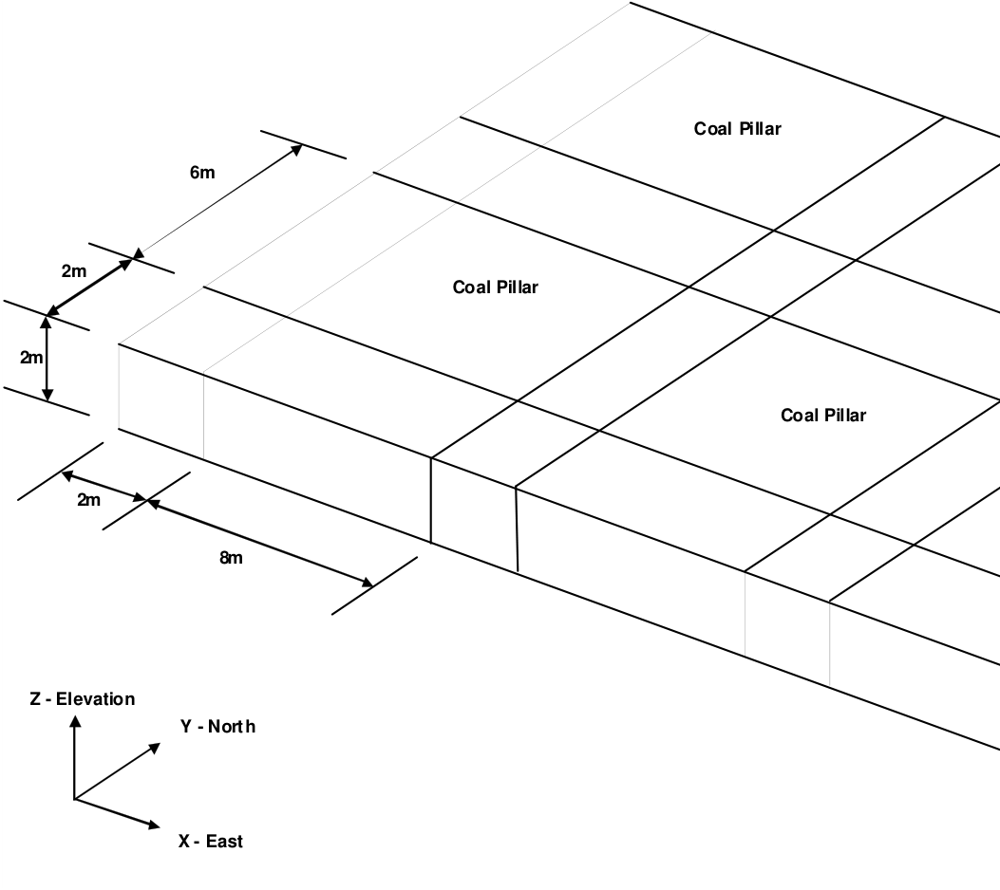

Para demonstrar a técnica de desenho à mão livre, vamos começar construindo uma geometria simples de lavra de carvão por câmaras e pilares. As galerias medem 2 m de largura por 2 m de altura, e os pilares de carvão medem 6 m na direção leste e 4 m na direção oeste.

Queremos começar do zero, então selecionaremos

File > New Model

Antes de começar, observe que você pode passar o cursor sobre qualquer botão para ver uma dica que identifica sua função. Também é possível clicar com o botão direito em qualquer item para obter ajuda detalhada sobre essa função.

#### Construção da interseção

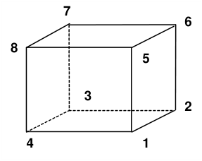

Primeiro vamos construir uma interseção, usando blocos com 8 vértices. Para construir o primeiro bloco, use CAD > Build > FFLoop. Essa função pode ser selecionada na barra de ferramentas CAD da seguinte forma (se a barra de ferramentas CAD não estiver visível, ative-a com Tools > CAD Toolbar):

#### Selecione CAD > Build na barra de ferramentas CAD

Será exibido o submenu de funções de construção

Agora selecione

#### CAD > Build > FFLoop

Como vamos desenhar à mão livre, precisamos configurar a grade de encaixe. Isso é feito com CAD > Snap > Rectangular Grid Snap. Essa função pode ser selecionada na barra de ferramentas Build Entity

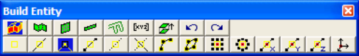

Para ativar a grade de encaixe, selecione

#### CAD > Snap > Rectangular Grid Snap

(isso só é necessário se o botão de encaixe na grade ainda não estiver destacado).

As coordenadas da posição atual do cursor são indicadas na barra de status. Você notará que os valores x e y mudam ao mover o cursor, mas o valor z não. Para definir o valor z atual, clique em CAD > Snap > Cursor/Grid Setup; será exibido o seguinte:

Defina a origem e o espaçamento de encaixe da seguinte forma:

X-Origin > 0 Y-Origin > 0 Z-Origin > 0 Snap spacing > 1

Se a mira do cursor não estiver se movendo no plano x-y, selecione o

botão.

Isso define o modo de encaixe como grade. Nesse modo, nenhuma caixa de seleção é exibida na interseção da mira, e o movimento do cursor fica restrito ao espaçamento de grade especificado. Ao mover o cursor pela tela, ele salta de uma posição para outra de acordo com o espaçamento da grade (1 metro neste caso).

Você verá que a rotina de construção FFLoop solicita, na barra de status, o primeiro vértice do bloco

Input: Select Point 1

Mova o cursor até localizar o primeiro ponto

x,y,z >  0  0  0

Selecione esse ponto clicando uma vez com o botão esquerdo do mouse.

Agora será solicitado o próximo vértice do bloco

Input: Select Point 2

Ao mover o cursor, você verá que, no canto inferior esquerdo da tela, é indicada não apenas a posição atual do cursor, mas também o deslocamento do ponto atual em relação ao último selecionado (ou seja, o vetor de deslocamento do ponto 1 ao ponto 2). Selecione o ponto 2 em

x,y,z >  2  0  0

Repita esse processo para o ponto 3

x,y,z >  2  2  0

e o ponto 4

x,y,z >  0  2  0

Se você selecionar o local errado para um ponto, basta desfazer essa seleção com o botão desfazer

#### CAD > Build > Undo Point e tentar novamente.

Por fim, selecione novamente o primeiro ponto

x,y,z >  0  0  0

Quando o primeiro ponto é selecionado novamente, a base do bloco está completamente formada. Será exibida a mensagem

Loop complete: Start next loop.

Para concluir o bloco, você pode alterar a cota e selecionar os 4 pontos restantes (ou seja, os pontos 5, 6, 7 e 8), ou gerá-los a partir dos 4 primeiros vértices somando um deslocamento a eles. Para usar esse último procedimento, selecione a função de deslocamento na barra de ferramentas Build Entity

#### CAD > Build > Extrude/Offset Remaining

O vetor de deslocamento será solicitado da seguinte forma

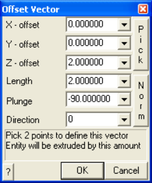

Informe o deslocamento:

X-offset > 0 Y-offset > 0 Z-offset > 2

Os pontos 5, 6, 7 e 8 serão gerados a partir dos pontos 1, 2, 3 e 4, respectivamente, somando os valores de deslocamento às suas coordenadas.

Ao concluir a construção do bloco, você será automaticamente solicitado a informar as propriedades do bloco (CAD > Build > FFLoop)

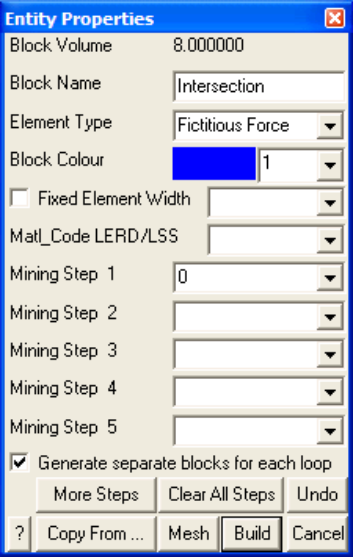

Informe o seguinte:

Block Name: Intersection Element Type: Fictitious Force Block Colour: 1

Esse bloco de interseção deve ser escavado na etapa de lavra 1. Isso é indicado especificando

Mining Step 1: 0

Terminamos e podemos construir esse bloco pressionando o

botão.

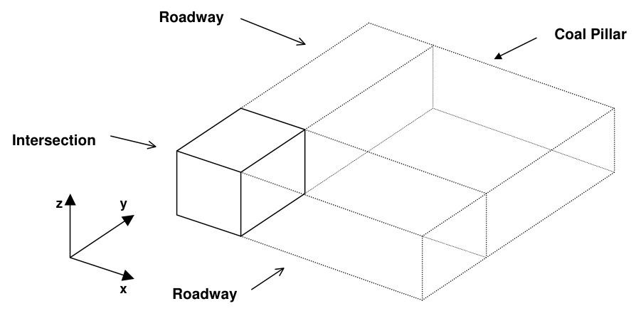

#### Reposicionamento da vista

Durante a construção de blocos, ou a qualquer momento, você pode reposicionar (transladar, girar ou aplicar zoom) a geometria para facilitar a visualização. Isso pode ser feito de várias formas (consulte Rotação do modelo e Translação do modelo).

#### Construção da galeria 1

Agora é possível construir blocos adicionais selecionando novamente a função de construção FFLoop

#### CAD > Build > FFLoop

Vamos construir o próximo bloco ao lado do primeiro. Selecione o ponto 1 em

x,y,z >  2  0  0

Gostaríamos de selecionar o ponto 2 em

x,y,z >  8  0  0

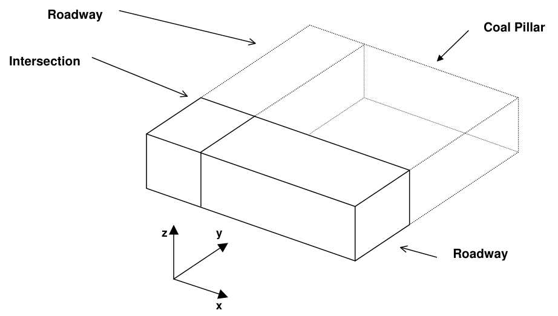

mas esse local está além dos limites da tela. Para resolver isso, basta afastar o zoom (Translação do modelo).

Agora o ponto 2 pode ser selecionado facilmente.

Selecione o ponto 3 em

x,y,z >  8  2  0

Selecione o ponto 4 em

x,y,z >  2  2  0

Por fim, selecione novamente o primeiro ponto

x,y,z >  2  0  0

Quando o primeiro ponto é selecionado novamente, a base do bloco está completamente formada. Como antes, será exibida a mensagem

Loop complete: Start next loop.

Agora desloque os pontos restantes desse bloco com a função de deslocamento

#### CAD > Build > Extrude/Offset Remaining

O vetor de deslocamento será solicitado da seguinte forma

Informe o deslocamento:

X-offset > 0 Y-offset > 0 Z-offset > 2

Ao concluir a construção do bloco, você será automaticamente solicitado a informar as propriedades da entidade (CAD > Build > FFLoop)

Informe o seguinte:

Block Name: Roadway

Element Type: Fictitious Force Block Colour: 1

Esse bloco de galeria deve ser escavado na etapa de lavra 1. Isso é indicado especificando Mining Step 1: 0

Terminamos e podemos construir esse bloco pressionando o botão.

#### Construção da galeria 2

Vamos construir um terceiro bloco

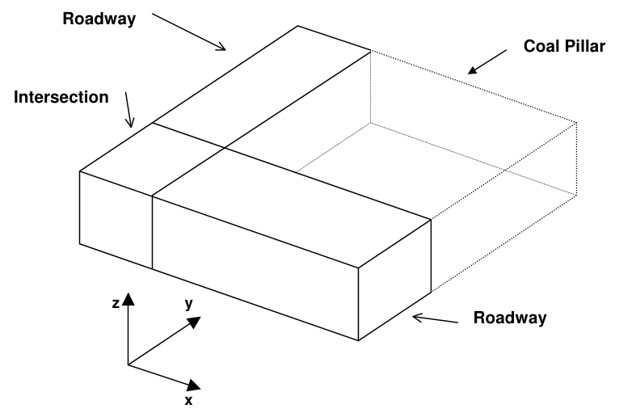

selecionando o ponto 1 em

x,y,z >  2  2  0

Selecione o ponto 2 em

x,y,z >  2  6  0

Selecione o ponto 3 em

x,y,z >  0  6  0

Selecione o ponto 4 em

x,y,z >  0  2  0

Selecione novamente o primeiro ponto para concluir a base

x,y,z >  2  0  0

e depois desloque os pontos restantes como antes

CAD > Build > Extrude/Offset Remaining

Isso conclui a construção da galeria.

#### Construção do pilar de carvão

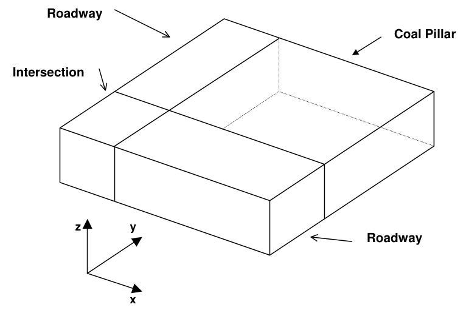

Agora você deve ter concluído a construção de uma interseção e duas galerias. Vamos construir um pilar de carvão.

#### CAD > Build > FFLoop

selecionando o ponto 1 em

x,y,z >  2  2  0

Selecione o ponto 2 em

x,y,z >  8  2  0

Selecione o ponto 3 em

x,y,z >  8  6  0

Selecione o ponto 4 em

x,y,z >  2  6  0

Selecione novamente o primeiro ponto para concluir a base

x,y,z >  2  2  0

e depois desloque os pontos restantes como antes

CAD > Build > Extrude/Offset Remaining

Isso conclui a construção do pilar de carvão.

Ao concluir a construção do bloco, você será automaticamente solicitado a informar as propriedades do bloco (CAD > Build > FFLoop). Precisamos especificar que esse bloco será um pilar de carvão, e não uma escavação (o padrão). Será exibido o seguinte:

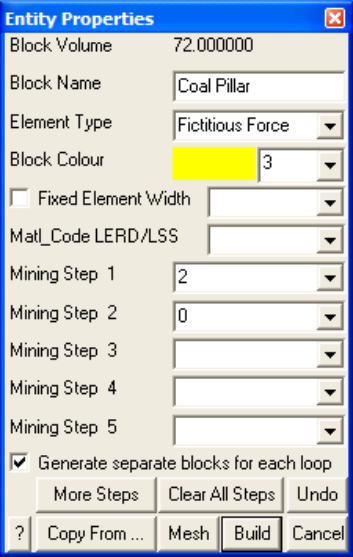

Informe o seguinte:

Block Name: Coal Pillar Element Type: Fictitious Force Block Colour: 3

Precisamos especificar que esse bloco tem as propriedades de material do carvão. Isso é feito definindo o material número 2 para o carvão na etapa de lavra 1. Isso é indicado especificando

Mining Step 1: 2

Esse mesmo pilar poderia ser escavado na etapa 2 especificando o código de material

Mining Step 2: 0

Terminamos e podemos construir esse bloco.

#### Salvar a geometria

Neste ponto, construímos um pequeno canto da geometria de lavra desejada. Antes de continuar, é uma boa ideia salvar o modelo construído até agora. Para isso, selecionamos

#### File > Save Model As

Vamos salvá-lo com o nome "COAL.INP"

#### Ampliação da geometria

O modelo construído representa apenas uma pequena parte do modelo final. É fácil repetir esse padrão copiando-o várias vezes. Para isso, selecione a função de cópia

CAD > Edit > Copy Entities

Essa função também pode ser selecionada na barra de ferramentas CAD da seguinte forma:

Selecione CAD > Edit na barra de ferramentas CAD

Será exibido o submenu de funções de edição

Para ativar a função de cópia, selecione

#### CAD > Edit > Copy Entities

Agora será solicitado que você crie uma lista de entidades a copiar

Mantenha pressionada a tecla Shift e arraste uma janela de seleção (como alternativa, você pode selecionar a função de janela de cruzamento).

**Segundo canto da janela**

Todas as entidades dentro da janela de seleção (ou seja, a interseção, as galerias e o pilar de carvão) devem ficar destacadas.

Agora você pode copiar as entidades selecionadas clicando no botão de cópia

Será solicitado o vetor de deslocamento da cópia da seguinte forma:

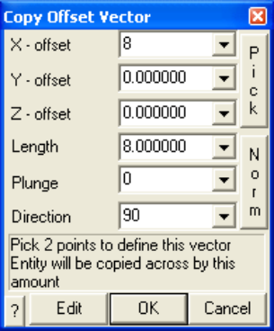

Há várias formas de selecionar o vetor de deslocamento da cópia. Você pode digitar o deslocamento desejado como (8  0 0).

Também é fácil fazer isso graficamente, selecionando dois pontos que definem o vetor. Primeiro defina o modo de encaixe como

#### CAD > Snap > Rectangular Grid Snap

(isso só é necessário se o botão de encaixe na grade ainda não estiver destacado).

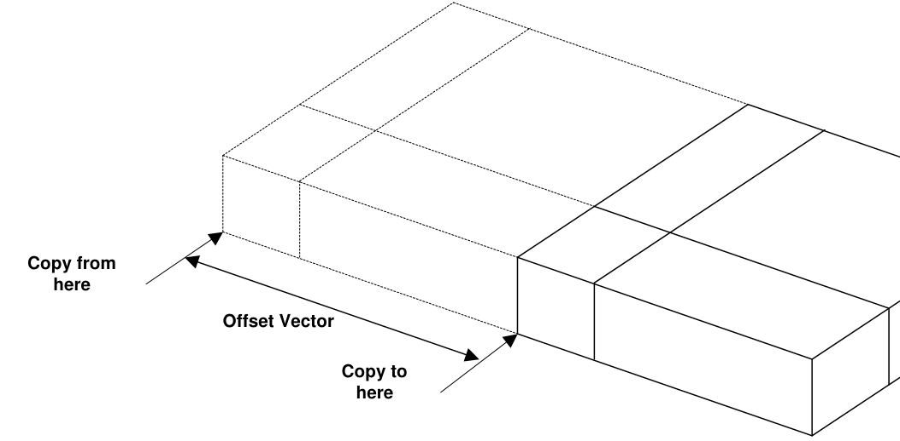

Será solicitado (na parte superior da tela) que você selecione a primeira extremidade do vetor de deslocamento

INPUT: Select first offset point

Selecione esse ponto em

x,y,z >  0  0  0

Em seguida, será solicitado que você selecione a outra extremidade do vetor de deslocamento

INPUT: Select second offset point

Selecione esse ponto em

x,y,z >  8  0  0

O deslocamento (8  0  0) será exibido na caixa de diálogo.

Agora pressione OK, e as entidades selecionadas serão copiadas somando o vetor de deslocamento a todas as coordenadas.

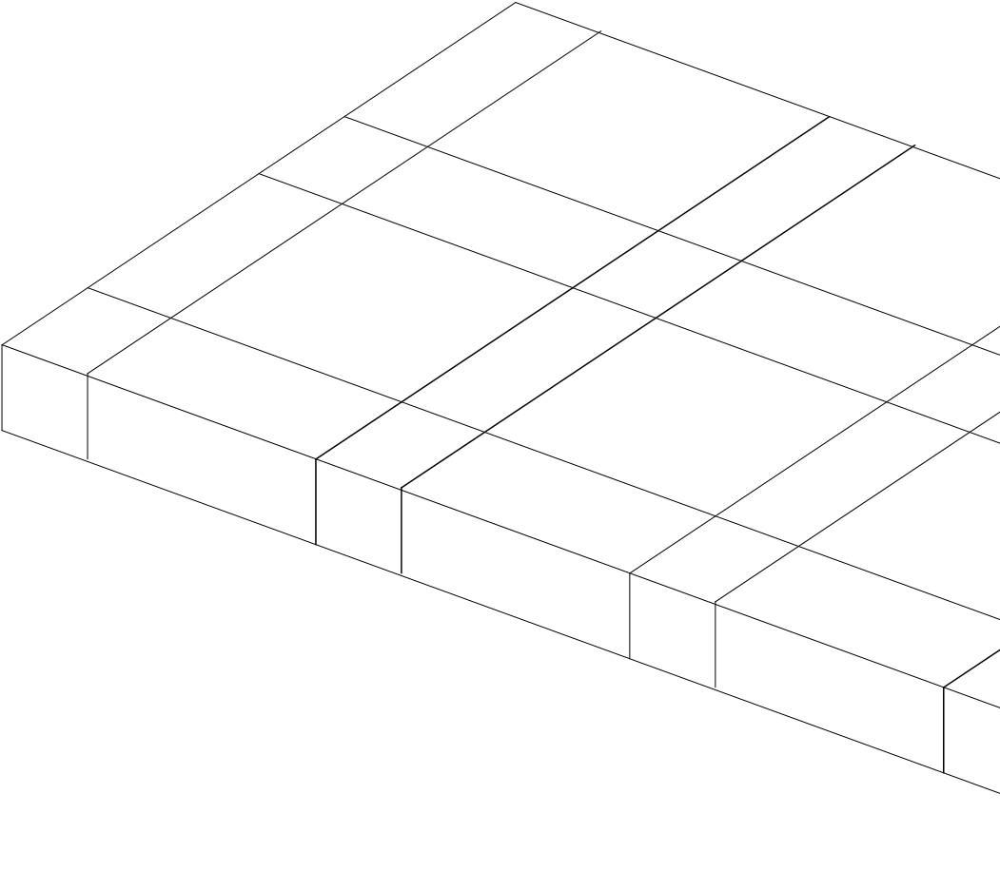

Para repetir essa cópia, recrie o conjunto de seleção ou restaure o conjunto de seleção anterior e copie as entidades selecionadas escolhendo novamente a função de cópia

#### CAD > Edit > Copy Entities

Se desejar, esse procedimento pode ser repetido quantas vezes quiser para duplicar o padrão de lavra nas direções x e y.

Neste ponto, a geometria pode ser considerada concluída. Agora precisamos definir a localização dos planos de grade onde os resultados serão calculados e especificar as propriedades de material.

#### Construção de planos de grade

**3 2 4 1**

Agora precisamos decidir onde queremos que os resultados sejam calculados. Neste exemplo, interessa-nos a tensão nos pilares de carvão. Por isso, definiremos um plano de grade em seção transversal que passe pelo centro de um dos pilares. Ele será construído como um plano de 4 vértices. Para construí-lo, selecione a função de menu de construção de grades

#### CAD > Build > Grid Plane

Essa função também pode ser selecionada na barra de ferramentas CAD da seguinte forma:

Selecione CAD > Build na barra de ferramentas CAD

Será exibido o submenu de funções de construção

Agora selecione

#### CAD > Build > Grid Plane

Como vamos desenhar à mão livre, precisamos configurar a grade de encaixe. Isso é feito com CAD > Snap > Rectangular Grid Snap. Essa função pode ser selecionada na barra de ferramentas Build Entity

Para ativar a grade de encaixe, selecione

#### CAD > Snap > Rectangular Grid Snap

(isso só é necessário se o botão de encaixe na grade ainda não estiver destacado).

As coordenadas da posição atual do cursor são indicadas na barra de status. Para definir o valor z atual, clique em CAD > Snap > Cursor/Grid Setup; será exibido o seguinte:

Defina a origem e o espaçamento de encaixe da seguinte forma:

X-Origin > 0 Y-Origin > 0 Z-Origin > -2 Snap spacing > 1

Se a mira do cursor não estiver se movendo no plano x-y, selecione o

botão.

Você verá que a rotina de construção do plano de grade solicita o primeiro vértice do plano

INPUT: Select point 1

Mova o cursor até localizar o ponto desejado

x,y,z >  9  4  -2

Selecione esse ponto clicando uma vez com o botão esquerdo do mouse.

Agora será solicitado o próximo vértice

INPUT: Select point 2

Selecione o ponto 2 em

x,y,z >  17  4  -2

Se você selecionar o local errado para um ponto, basta desfazer essa seleção

CAD > Build > Undo Point

e tentar novamente.

Depois de selecionar o ponto 2, uma aresta do plano está completamente formada. Para concluir o plano, você pode alterar a cota e selecionar os 2 pontos restantes (ou seja, os pontos 3 e 4), ou gerá-los a partir dos 2 primeiros vértices somando um deslocamento a eles. Para usar esse último procedimento, selecione a função de deslocamento na barra de ferramentas Build Entity

CAD > Build > Offset Remaining

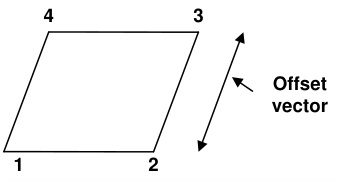

O vetor de deslocamento será solicitado da seguinte forma

Informe o deslocamento:

X-offset > 0 Y-offset > 0 Z-offset > 6

Os pontos 3 e 4 serão gerados a partir dos pontos 2 e 1, respectivamente, somando os valores de deslocamento às suas coordenadas.

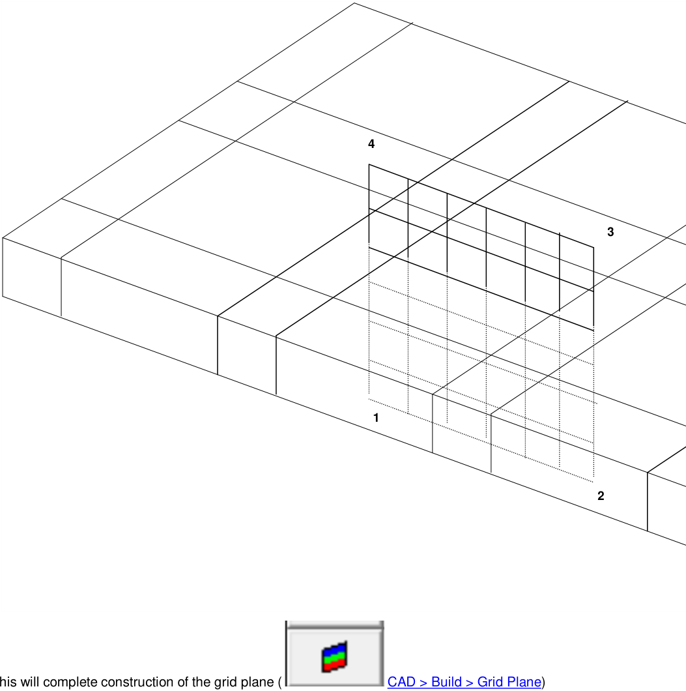

Isso conclui a construção do plano de grade (

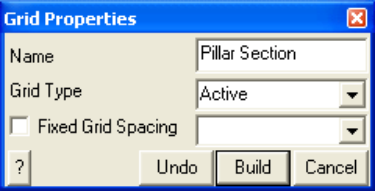

Informe um nome descritivo para o plano de grade e deixe a caixa Fixed Grid Spacing desmarcada.

#### Especificação das propriedades de material do arenito encaixante

Agora precisamos especificar as propriedades do material encaixante. Elas são informadas com a função de propriedades de material

#### CAD > Properties > Material Properties.

Esse item abre um submenu relacionado à edição das propriedades de material. Observe que o material número 1 é, por definição, o material encaixante. Os outros números de material são usados para definir zonas de materiais alternativos, como o carvão, o preenchimento de falha, o enchimento etc. Primeiro será solicitado o número do material a ser editado. Vamos definir primeiro as propriedades do material encaixante

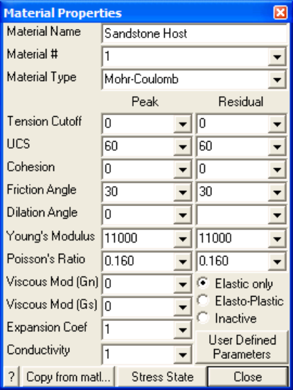

Informe o seguinte:

Material Name: Sandstone Host Material # : 1 Young's (deformation) Modulus: 11000 MPa Poisson's Ratio: 0.16

Os módulos viscosos podem ser definidos como zero, pois só são usados para simular fluência na análise não linear.

Queremos usar aqui o critério de Mohr-Coulomb. Para isso, defina

Material Type: Mohr-Coulomb UCS: 60 MPa

O parâmetro de coesão não é usado neste caso e, portanto, pode ser definido como zero.

Friction Angle: 30°

O ângulo de dilatância não é usado neste caso e, portanto, pode ser definido como zero.

Agora é possível especificar o estado de tensões pré-lavra

CAD > Properties > Material Properties > Stress State

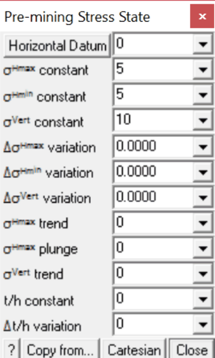

O estado de tensões de campo distante adequado para este modelo é

sHmax constant:  5 MPa sHmin constant:  5 MPa sVert constant: 10 MPa

Definiremos como zero a variação das tensões com a profundidade

DsHmax variation:  0 MPa/m DsHmin variation:  0 MPa/m DsVert variation:  0 MPa/m

Além disso, as orientações das tensões (direção e caimento) devem ser definidas como zero, o que define sa e sb como horizontais e sc como vertical.

O datum também pode ser definido como zero, pois só é usado para definir a variação com a profundidade.

#### Especificação das propriedades de material da camada de carvão

Agora precisamos especificar as propriedades da camada de carvão. Elas são informadas com a função de propriedades de material

#### CAD > Properties > Material Properties

Esse item abre um submenu relacionado à edição das propriedades de material. Lembre-se de que, ao construir o pilar de carvão, especificamos que o material número 2 seria usado para esse bloco.

Vamos definir Material # como 2.

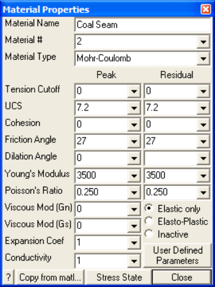

Informe o seguinte:

Material Name: Coal Seam Young's  (deformation) Modulus: 3500 MPa Poisson's Ratio: 0.25

Os módulos viscosos podem ser definidos como zero, pois só são usados para simular fluência na análise não linear.

Queremos usar aqui o critério de Mohr-Coulomb. Para isso, defina

Material Type: Mohr-Coulomb UCS: 7.2 MPa

O parâmetro de coesão não é usado neste caso e, portanto, pode ser definido como zero.

Friction Angle: 27°

O ângulo de dilatância não é usado neste caso e, portanto, pode ser definido como zero.

Agora é possível especificar o estado de tensões pré-lavra

#### CAD > Properties > Material Properties > Stress State

Queremos que a tensão inicial no carvão seja igual à do arenito encaixante; então, vamos usar Copy para copiá-la do material 1.

#### Especificação dos parâmetros de controle

Agora precisamos especificar os parâmetros que controlam a discretização e a solução do modelo. Eles são informados com a função de parâmetros de controle

#### CAD > Properties > Control Parameters

Esse item abre uma caixa de diálogo com os itens relacionados aos parâmetros de controle

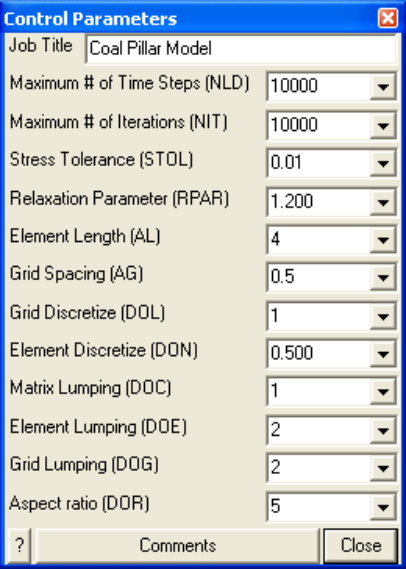

Informe o seguinte:

Job Title: Coal Pillar Model

Todos os parâmetros podem ficar com seus valores padrão, exceto a tolerância de tensão, o comprimento de elemento e o espaçamento de grade.

Stress Tolerance: 0.01 MPa

deve ser aproximadamente 0,1% do estado de tensões de campo distante. Isso garante que, durante a solução, as tensões superficiais sejam calculadas com precisão numérica de 0,01 MPa.

Element Length: 4

deve ser igual ao dobro da espessura da camada de carvão. Esse parâmetro controla o tamanho mínimo dos elementos de contorno usados em locais com camadas ou pilares estreitos. Isso garante a formulação de um problema bem condicionado e fácil de resolver.

Grid Spacing: 0.5

deve ser aproximadamente um quarto da espessura da camada. Esse parâmetro controla o tamanho mínimo dos elementos de contorno e o espaçamento mínimo no plano de grade nos locais onde ele passa perto do modelo ou o intercepta. É possível obter resultados precisos até uma distância de metade desse espaçamento das superfícies do modelo. Esse parâmetro também garante que um número suficiente de pontos de tensão seja calculado dentro do pilar para gerar contornos suaves.

O usuário pode escolher um valor maior para o espaçamento de grade. Isso resultará em um problema menor e, portanto, em tempos de processamento mais curtos. No entanto, com elementos de contorno maiores, os resultados serão menos precisos, especialmente perto das superfícies do modelo; além disso, com espaçamento de grade maior, não é possível gerar contornos suaves.

Os valores sugeridos para os parâmetros de discretização e agrupamento são os seguintes:

_DON_ =0.5, _DOL_ = _DOC_ =1, _DOE_ = _DOG_ =2 para erro de 10-20% _DON_ =0.5, _DOL_ = _DOC_ =2, _DOE_ = _DOG_ =4 para erro de 5-10% _DON_ =1.0, _DOL_ =DOC=4, _DOE_ = _DOG_ =8 para erro &lt; 5%

As configurações para resultados de análise grosseiros são recomendadas para todos os problemas, exceto aqueles que exigem maior precisão. Com essa configuração, pode-se esperar erros numéricos de 10-20% nas previsões de tensão. As configurações para resultados detalhados fornecem erro numérico de 5-10%, e as de alta precisão, erro inferior a 5%. O usuário pode especificar configurações de maior precisão, mas isso resultará em um problema maior e, portanto, em tempos de processamento mais longos.

#### Execução de uma análise no Map3D

Neste ponto, concluímos a construção do modelo e estamos prontos para iniciar uma análise. Se você estiver usando o Map3D Fault-Slip, obterá uma solução elástica para este problema. Se estiver usando o Map3D NonLinear, será realizada uma análise não linear completa.

A análise é executada a partir do menu principal.

Você pode executar a análise completa selecionando

#### BEM Analysis

Aqui faremos isso por etapas. Então, primeiro selecione

#### Discretization

Se você tiver modificado o modelo desde a última vez que salvou, será solicitado a salvar as modificações.

Quando as análises de interseção e discretização estiverem concluídas, selecione

#### Analysis > Graphics

No modo gráfico, selecione a opção de vista discretizada

#### View > Render > Discretize

Isso permitirá ver como as superfícies dos blocos foram discretizadas em elementos de contorno. Os contornos dos blocos precisam estar ativados para ver os elementos individuais

#### View > Render > Block Outlines

Para ver como a grade foi discretizada (se a barra de ferramentas de contornos não estiver visível, ative-a com Tools > CAD Toolbar), selecione

#### Plot > Grid Selection > Grid #1

na barra de ferramentas de contornos

A análise de discretização pode ser repetida quantas vezes desejar, com diferentes valores de espaçamento de grade e de parâmetros de discretização e agrupamento, até obter a densidade desejada de elementos de contorno e pontos de grade.

Quando estiver satisfeito, prossiga para a análise BEM (montagem e solução da matriz) selecionando

#### Analysis

no menu principal e depois

#### BEM Analysis

Quando a análise terminar, selecione

#### Analysis > Graphics

No modo gráfico, é possível gerar contornos de qualquer parâmetro desejado. Por exemplo, para exibir os contornos da tensão principal maior, selecione

Plot > Stress > S1 Major Principal Stress

Isso gerará uma plotagem de contornos no plano de grade.

A interpretação dos resultados não será discutida aqui.
