Este exemplo demonstra a construção de um modelo para um caso de lavra tabular em várias etapas.

As linhas de construção são usadas para definir a localização detalhada de feições subterrâneas, como escavações, contatos, estruturas etc. Normalmente, um modelo do Map3D é construído sobre esses dados de linhas de construção.

As plantas de mina foram previamente digitalizadas com o Map3D

#### CAD > Digitizer Setup

ou com outro programa CAD. Essas plantas podem ser salvas em um dos seguintes formatos:

O formato de arquivo de pontos é um arquivo de dados ASCII universal com a extensão ".PNT". Esse formato é útil para trocar dados brutos de linhas de construção com outros softwares CAD.

O formato AutoCAD-DXF é um formato popular de intercâmbio de desenhos com a extensão ".DXF". Esse formato é útil para trocar dados de linhas de construção com outros softwares CAD.

Queremos começar do zero, então selecionaremos

#### File > New Model

Antes de começar, observe que você pode passar o cursor sobre qualquer botão para ver uma dica que identifica sua função. Também é possível clicar com o botão direito em qualquer item para obter ajuda detalhada sobre essa função.

#### Importação das plantas de mina digitalizadas

Primeiro precisamos abrir um arquivo com as plantas de mina digitalizadas. Isso é feito com

#### File > Open Construction Lines

Neste caso, as linhas de construção foram salvas no formato PNT. O arquivo "TAB.pnt" está incluído na instalação do Map3D e deve estar disponível para importação.

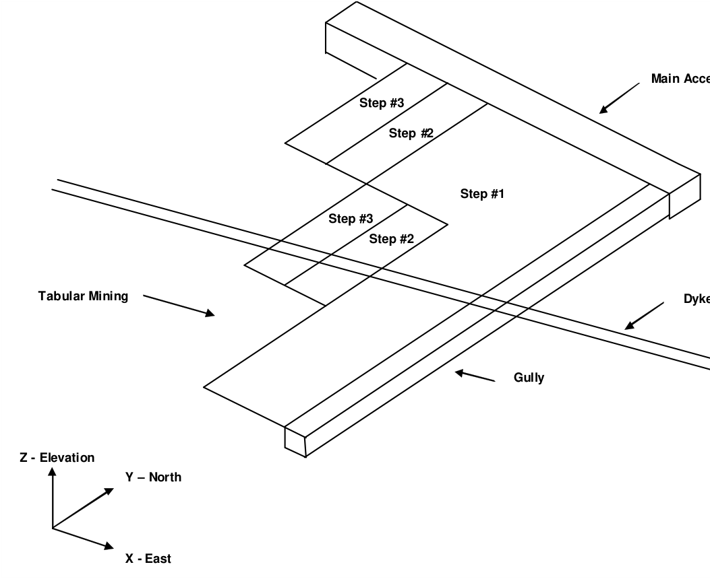

#### Reposicionamento da vista

Durante a construção de blocos, ou a qualquer momento, você pode reposicionar (transladar, girar ou aplicar zoom) a geometria para facilitar a visualização. Isso pode ser feito de várias formas (consulte Rotação do modelo e Translação do modelo). A forma mais fácil de girar é manter pressionado o botão esquerdo do mouse enquanto arrasta o cursor pela tela. A translação é feita mantendo pressionado o botão direito. Para aproximar ou afastar o modelo, mantenha pressionados os dois botões do mouse.

Posicione a vista de modo que as linhas de construção fiquem bem visíveis.

#### Construção da etapa de lavra nº 1

Vamos agora construir a etapa de lavra tabular nº 1. Ela será construída com elementos de descontinuidade de deslocamento, definidos pelo perímetro da zona lavrada.

Para construir o primeiro bloco, use CAD > Build > DDLoop. Essa função pode ser selecionada na barra de ferramentas CAD da seguinte forma (se a barra de ferramentas CAD não estiver visível, ative-a com Tools > CAD Toolbar):

Selecione CAD > Build na barra de ferramentas CAD

Será exibido o submenu de funções de construção

Agora selecione

#### CAD > Build > DDLoop

Como queremos encaixar nas linhas de construção, precisamos definir o modo de encaixe. Isso é feito com CAD > Snap > Nearest Edge. Essa função pode ser selecionada na barra de ferramentas Build Entity

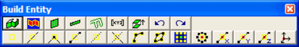

Para ativar o encaixe na aresta mais próxima, selecione

#### CAD > Snap > Nearest Edge

(isso só é necessário se o botão de encaixe na aresta mais próxima ainda não estiver destacado).

Nesse modo, uma caixa de seleção será exibida na interseção da mira. Embora as coordenadas da posição atual do cursor sejam indicadas na barra de status, se a caixa de seleção estiver sobre o vértice de uma linha de construção, esse vértice será selecionado; caso contrário, será selecionado o ponto mais próximo na aresta da linha de construção sob a caixa de seleção. Em ambos os casos, os 3 valores de coordenadas (x, y e z) ficam definidos de forma única.

Você verá que a rotina de construção DDLoop solicita, na barra de status, o primeiro vértice do bloco

Input: Select Point 1

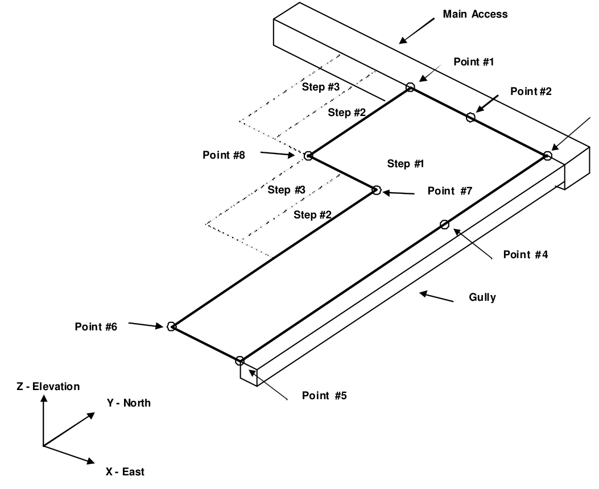

Selecione os pontos 1 a 8 como mostrado.

Observe que poderíamos usar aqui o modo de encaixe em vértices

#### CAD > Snap > Nearest Corner

para todos os pontos, exceto o 2 e o 4.

Se você selecionar o local errado para um ponto, basta desfazer essa seleção

#### CAD > Build > Undo Point

e tentar novamente.

Os pontos 2 e 4 são opcionais e só foram selecionados para gerar um modelo de aparência mais organizada.

Depois de selecionar o ponto nº 8, a planta está completa. Para concluir o DDLoop, selecione novamente o ponto nº 1 ou clique no botão.

Você será automaticamente solicitado a informar as propriedades do bloco (CAD > Build > DDLoop)

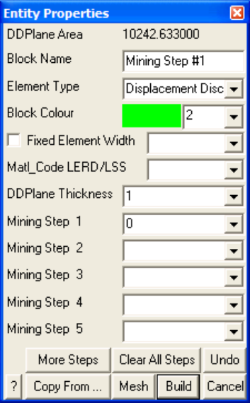

Informe o seguinte:

Block Name: Mining Step #1 Element Type: Displacement Discontinuity Block Colour: 2 DDPlane Thickness: 1

DDPlane Thickness deve ser igual à espessura lavrada.

Essa lavra tabular deve ser escavada na etapa de lavra 1. Isso é indicado especificando

Mining Step 1: 0

Terminamos e podemos construir esse bloco pressionando o botão.

#### Construção da etapa de lavra nº 2

Vamos agora construir a etapa de lavra tabular nº 2. Ela também será construída com elementos de descontinuidade de deslocamento, definidos pelo perímetro da zona lavrada. Para começar, selecione

CAD > Build > DDLoop

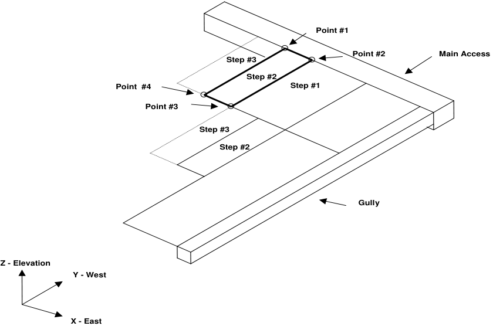

Selecione os 4 pontos como mostrado.

Depois de selecionar o ponto 4, a planta está completa. Para concluir o DDLoop, selecione novamente o ponto nº 1 ou clique no botão.

Você será automaticamente solicitado a informar as propriedades do bloco (

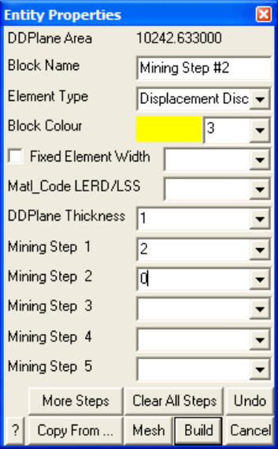

Informe o seguinte:

Block Name: Mining Step #2 Element Type: Displacement Discontinuity Block Colour: 3 DDPlane Thickness: 1

DDPlane Thickness deve ser igual à espessura lavrada.

Essa lavra tabular deve receber as propriedades do minério (material nº 2) na etapa de lavra 1 e, em seguida, ser escavada na etapa de lavra 2. Isso é indicado especificando

Mining Step 1: 2 Mining Step 2: 0

Terminamos e podemos construir esse bloco pressionando o botão.

Agora construa a outra parte da etapa 2 com o mesmo procedimento.

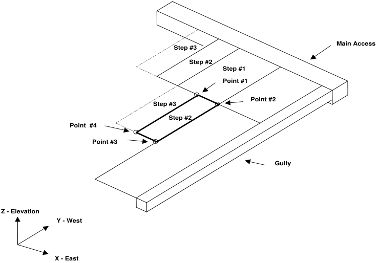

#### Construção da etapa de lavra nº 3

Essa lavra pode ser construída da mesma forma que a da etapa 2, exceto que ela deve receber as propriedades do minério (material nº 2) nas etapas de lavra 1 e 2 e, em seguida, ser escavada na etapa de lavra 3.

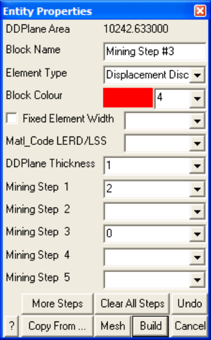

#### Obtenção de resultados

Embora tenhamos definido a geometria de lavra, ainda precisamos especificar onde queremos obter previsões de tensão. Por padrão, elas serão obtidas em todos os planos DD não lavrados. Se também quisermos tensões fora do recife, ou à frente da zona lavrada, precisamos posicionar planos DD ou planos de grade nesses locais. Os planos de grade são uma alternativa muito mais econômica (em termos de tempo de análise).

Neste caso, optamos por obter resultados apenas nos planos DD. Vamos forçar a discretização desses planos para um tamanho de elemento adequado com o parâmetro Fixed Element Width. Para isso, use CAD > Edit > Properties > Entity Properties. Essa função pode ser selecionada na barra de ferramentas CAD da seguinte forma (se a barra de ferramentas CAD não estiver visível, ative-a com Tools > CAD Toolbar):

Selecione CAD > Edit na barra de ferramentas CAD

Será exibido o submenu de funções de edição

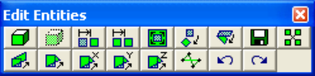

Agora selecione

CAD > Edit > Entity Properties

Isso abrirá a barra de ferramentas de edição de entidades

Ao iniciar essa rotina, primeiro será solicitado que você crie uma lista das entidades que deseja editar. Mantenha pressionada a tecla Shift e selecione todos os planos DD que representam as etapas de lavra.

Depois de selecionar toda a lavra, selecione novamente

#### CAD > Edit > Entity Properties

ou clique duas vezes em qualquer entidade para abrir a caixa de diálogo Entity Properties.

Se algum campo da caixa de diálogo mostrar "Variable", é porque alguns dos blocos selecionados têm propriedades diferentes nesse campo. Se quiser manter essas propriedades como estão (ou seja, diferentes para cada bloco), deixe o campo como "Variable". Se quiser alterar o valor desse campo para todos os blocos selecionados, informe o valor desejado.

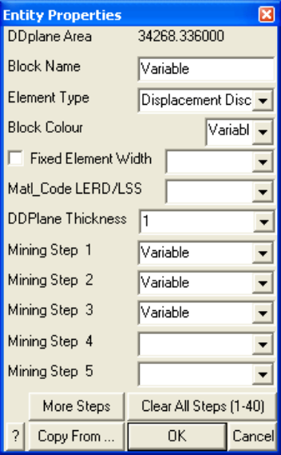

Neste caso, o único campo que queremos alterar é

Fixed Element Width:  20

Defina esse valor como 20 e selecione OK.

Isso forçará o Map3D a subdividir a zona lavrada em elementos uniformes com 20 metros de largura durante a discretização. Esse parâmetro pode ser reduzido posteriormente se for desejada uma discretização mais fina.

#### Salvar a geometria

Neste exemplo, vamos supor que a geometria definida até agora é satisfatória. Como a geometria final e a sequência de lavra estão concluídas, devemos salvar o modelo. Para isso, selecionamos

#### File > Save Model As

Vamos salvá-lo com o nome "TAB.INP"

#### Construção do dique

Como complicação adicional, vamos agora construir o dique. Para isso, use CAD > Build > FFLoop. Essa função pode ser selecionada na barra de ferramentas CAD da seguinte forma (se a barra de ferramentas CAD não estiver visível, ative-a com Tools > CAD Toolbar):

Selecione CAD > Build na barra de ferramentas CAD

Será exibido o submenu de funções de construção

Agora selecione

#### CAD > Build > FFLoop

Como queremos encaixar nos vértices das linhas de construção, precisamos definir o modo de encaixe. Isso é feito com CAD > Snap > Nearest Corner. Essa função pode ser selecionada na barra de ferramentas Build Entity

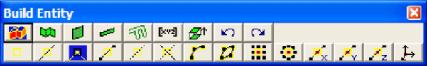

Para ativar o encaixe no vértice mais próximo, selecione

#### CAD > Snap > Nearest Corner

(isso só é necessário se o botão Nearest Corner Snap ainda não estiver destacado).

Na verdade, poderíamos usar aqui o modo de encaixe em arestas

#### CAD > Snap > Nearest Edge

já que os vértices das linhas de construção seriam selecionados de qualquer forma (desde que o vértice esteja dentro da caixa de seleção). No entanto, o encaixe em vértices permite uma seleção menos precisa, pois apenas vértices são selecionados.

Selecione os quatro pontos como mostrado na figura.

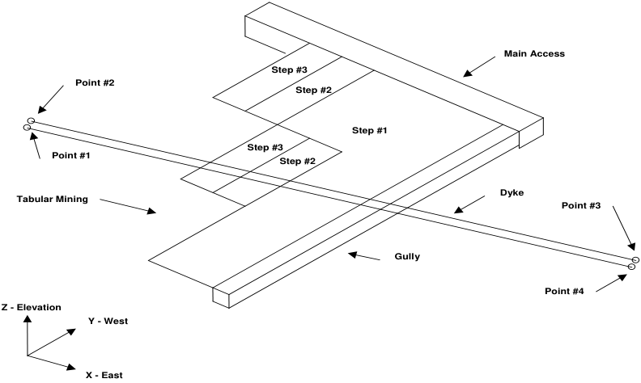

Se você selecionar o local errado para um ponto, basta desfazer essa seleção com o botão desfazer

#### CAD > Build > Undo Point e tentar novamente.

Por fim, selecione novamente o primeiro ponto (ou seja, o ponto nº 1).

Quando o primeiro ponto é selecionado novamente, a base do bloco está completamente formada. Será exibida a mensagem

#### Loop complete: Start next loop.

Para concluir o bloco, geraremos os 4 pontos restantes a partir dos 4 primeiros vértices, somando um deslocamento a eles. Para isso, selecione a função de deslocamento na barra de ferramentas Build Entity

#### CAD > Build > Extrude/Offset Remaining

O vetor de deslocamento será solicitado da seguinte forma

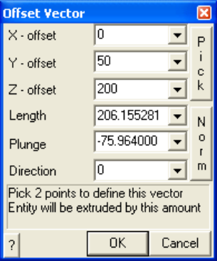

Informe o deslocamento:

X-offset > 0 Y-offset > 50 Z-offset > 200

Os pontos 5, 6, 7 e 8 serão gerados a partir dos pontos 1, 2, 3 e 4, respectivamente, somando os valores de deslocamento às suas coordenadas.

Ao concluir a construção do bloco, você será automaticamente solicitado a informar as propriedades do bloco (CAD > Build > FFLoop)

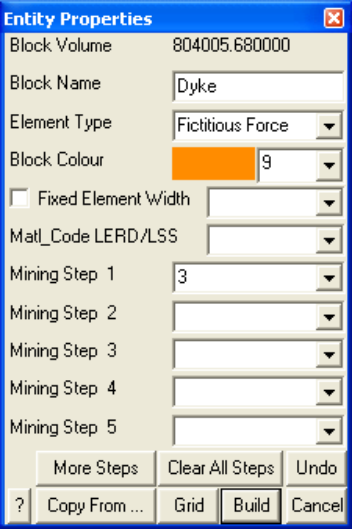

Informe o seguinte:

Block Name: Dyke Element Type: Fictitious Force Block Colour: 9

Desmarque Fixed Element Width para desativar esse recurso

Esse dique deve receber o material nº 3 na etapa de lavra 1. Isso é indicado especificando

Mining Step 1: 3

Terminamos e podemos construir esse bloco pressionando o

botão.

Também precisamos estender o dique abaixo da lavra. Para isso, podemos copiar esse bloco para baixo da lavra. Selecione

CAD > Edit na barra de ferramentas CAD

Isso abrirá a barra de ferramentas de edição

Para copiar entidades, selecione

CAD > Edit > Copy Entities

Isso abrirá a barra de ferramentas de cópia de entidades

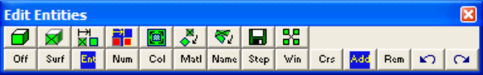

Ao iniciar essa rotina, primeiro será solicitado que você crie uma lista das entidades que deseja editar. Clique no dique. Isso abrirá a caixa de diálogo do vetor de deslocamento da cópia

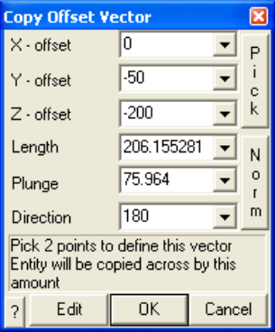

Vamos selecionar essa posição graficamente com a função Pick.

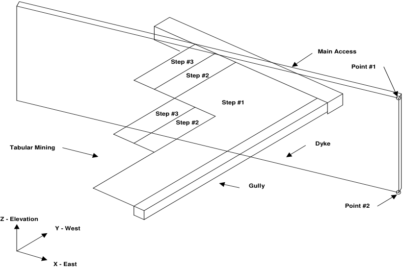

Isso definirá o vetor de deslocamento

X - offset: 0

Y - offset: -50

Z - offset: -200

Agora selecione OK. Isso copiará o dique para baixo da lavra.

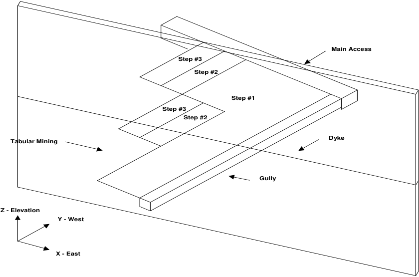

Isso conclui a construção do modelo.

#### Especificação das propriedades de material da rocha encaixante

Agora precisamos especificar as propriedades do material encaixante. Elas são informadas com a função de propriedades de material

#### CAD > Properties > Material Properties

Esse item abre um submenu relacionado à edição das propriedades de material. Observe que o material número 1 é, por definição, o material encaixante. Os outros números de material são usados para definir zonas de materiais alternativos, como minério, preenchimento de falha, enchimento etc. Primeiro será solicitado o número do material a ser editado. Vamos definir primeiro as propriedades do material encaixante

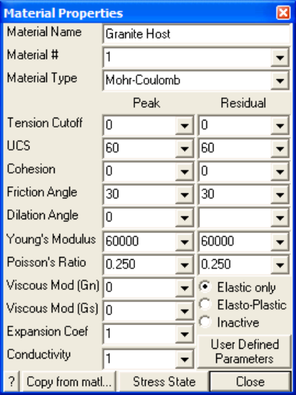

Informe o seguinte:

Material Name: Granite Host Material #: 1 Young's (deformation) Modulus: 60000 MPa Poisson's Ratio: 0.25

Os módulos viscosos podem ser definidos como zero, pois só são usados para simular fluência na análise não linear.

Queremos usar aqui o critério de Mohr-Coulomb. Para isso, defina

Material Type: Mohr-Coulomb UCS: 60 MPa

O parâmetro de coesão não é usado neste caso e, portanto, pode ser definido como zero.

Friction angle: 30°

O ângulo de dilatância não é usado neste caso e, portanto, pode ser definido como zero.

Selecione Stress State para abrir a caixa de diálogo do estado de tensões

O estado de tensões de campo distante adequado para este modelo é

sa constant:  30 MPa sb constant:  20 MPa sc constant:  20 MPa

Definiremos a variação das tensões com a profundidade como

Dsa variation:  -0.027 MPa/m Dsb variation:  -0.013 MPa/m Dsc variation:  -0.013 MPa/m

Além disso, as orientações das tensões (direção e caimento) devem ser definidas como zero, o que define sa e sb como horizontais e sc como vertical.

O datum pode ser definido como 1000 metros para definir a variação com a profundidade como

s + Ds ( _z_ - _Datum_ )

Assim definida, a tensão sa é igual a 30 MPa na profundidade z de 1000 m e aumenta à taxa de 0,027 MPa por metro de profundidade.

#### Especificação das propriedades de material do minério

Agora precisamos especificar as propriedades do minério. Elas são informadas com a função de propriedades de material

#### CAD > Properties > Material Properties

Esse item abre um submenu relacionado à edição das propriedades de material. Observe que o material número 1 é, por definição, o material encaixante. Os outros números de material são usados para definir zonas de materiais alternativos, como minério, preenchimento de falha, enchimento etc. Primeiro será solicitado o número do material a ser editado.

Vamos definir Material # como 2.

Todos os parâmetros podem ser definidos conforme desejado. Neste caso, é preciso ter cuidado especial, pois esse material é inserido em planos DD. Essas feições podem ter comportamento não linear, plastificando em compressão e cisalhamento (consulte a seção sobre Mohr-Coulomb em planos DD).

Selecione Stress State para abrir a caixa de diálogo do estado de tensões

Queremos que a tensão inicial no minério seja igual à da rocha encaixante; então, vamos usar Copy para copiá-la do material 1.

#### Especificação das propriedades de material do dique

Agora precisamos especificar as propriedades do dique. Elas são informadas com a função de propriedades de material

#### CAD > Properties > Material Properties

Esse item abre um submenu relacionado à edição das propriedades de material. Observe que o material número 1 é, por definição, o material encaixante. Os outros números de material são usados para definir zonas de materiais alternativos, como minério, preenchimento de falha, enchimento etc. Primeiro será solicitado o número do material a ser editado.

Vamos definir Material # como 3.

Todos os parâmetros podem ser definidos conforme desejado. Se estiver usando o Map3D Non-Linear, tenha cuidado especial neste caso, pois essa feição pode ter comportamento não linear, plastificando em compressão e cisalhamento (consulte a seção sobre Mohr-Coulomb em blocos FF 3D).

Não deixe de selecionar Stress State para abrir a caixa de diálogo do estado de tensões e definir o estado de tensões do dique igual ao da rocha encaixante (Copy do material 1).

#### Especificação dos parâmetros de controle

Agora precisamos especificar os parâmetros que controlam a discretização e a solução do modelo. Eles são informados com a função de parâmetros de controle

#### CAD > Properties > Control Parameters

Esse item abre uma caixa de diálogo com os itens relacionados aos parâmetros de controle

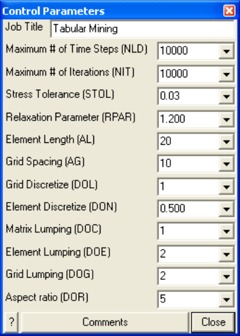

Informe o seguinte:

Job Title: Tabular Mining

Todos os parâmetros podem ficar com seus valores padrão, exceto a tolerância de tensão, o comprimento de elemento e o espaçamento de grade.

Stress Tolerance: 0.03 MPa

deve ser aproximadamente 0,1% do estado de tensões de campo distante. Isso garante que, durante a solução, as tensões superficiais sejam calculadas com precisão numérica de 0,03 MPa.

Element Length: 20

deve ser igual ao dobro da espessura do dique (o dique tem 10 metros de espessura), pois essa é a feição mais estreita deste modelo. Esse parâmetro controla o tamanho mínimo dos elementos de contorno usados em locais com camadas ou pilares estreitos. Isso garante a formulação de um problema bem condicionado e fácil de resolver.

O espaçamento de grade (Grid Spacing) não é usado, pois não definimos nenhuma grade de pontos de campo.

Os valores sugeridos para os parâmetros de discretização e agrupamento são os seguintes:

_DON_ =0.5, _DOL_ = _DOC_ =1, _DOE_ = _DOG_ =2 para erro de 10-20% _DON_ =0.5, _DOL_ = _DOC_ =2, _DOE_ = _DOG_ =4 para erro de 5-10% _DON_ =1.0, _DOL_ =DOC=4, _DOE_ = _DOG_ =8 para erro &lt; 5%

As configurações para resultados de análise grosseiros são recomendadas para todos os problemas, exceto aqueles que exigem maior precisão. Com essa configuração, pode-se esperar erros numéricos de 10-20% nas previsões de tensão. As configurações para resultados detalhados fornecem erro numérico de 5-10%, e as de alta precisão, erro inferior a 5%. O usuário pode especificar configurações de maior precisão, mas isso resultará em um problema maior e, portanto, em tempos de processamento mais longos.

#### Execução de uma análise no Map3D

Neste ponto, concluímos a construção do modelo e estamos prontos para iniciar uma análise. Se você estiver usando o Map3D Fault-Slip, obterá uma solução elástica para este problema. Se estiver usando o Map3D NonLinear, será realizada uma análise não linear completa.

A análise é executada a partir do menu principal.

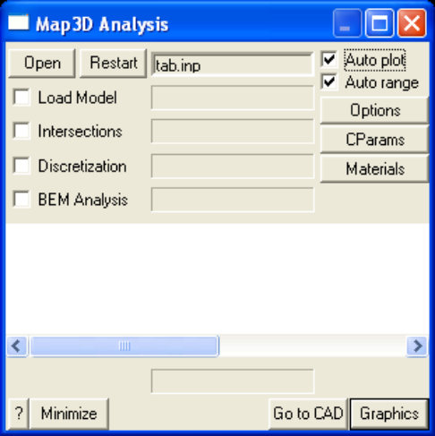

Você pode executar a análise completa selecionando

#### BEM Analysis

Aqui faremos isso por etapas. Então, primeiro selecione

#### Discretization

Se você tiver modificado o modelo desde a última vez que salvou, será solicitado a salvar as modificações.

Quando as análises de interseção e discretização estiverem concluídas, selecione

#### Analysis > Graphics

No modo gráfico, selecione a opção de vista discretizada

#### View > Render > Discretize

Isso permitirá ver como as superfícies dos blocos foram discretizadas em elementos de contorno. Os contornos dos blocos precisam estar ativados para ver os elementos individuais

#### View > Render > Block Outlines

Para ver como a grade foi discretizada, selecione

#### Plot > Grid Selection > Grid #1

Se tudo estiver satisfatório, prossiga para a análise BEM (montagem e solução da matriz) selecionando

#### Analysis

no menu principal e depois

#### BEM Analysis

Quando a análise terminar, selecione

#### Analysis > Graphics

No modo gráfico, é possível gerar contornos de qualquer parâmetro desejado. Por exemplo, para exibir o deslocamento normal (convergência) na lavra tabular, selecione

#### Plot > Surface Components > Dn Normal Displacement (Closure)

Isso gerará uma plotagem de contornos nos planos DD.

#### Construção do acesso principal

Ele será construído desenhando uma planta com DDLoop e, em seguida, extrudando-a em um bloco 3D.

Para isso, precisamos voltar à etapa CAD da análise do Map3D selecionando

#### Analysis > Go to CAD

na caixa de diálogo de análise. Em seguida, selecione

#### Analysis > Graphics

Para começar, selecione a função de menu de construção DDLoop

#### CAD > Build > DD Loop

Defina o modo de encaixe como aresta mais próxima (ou vértice mais próximo)

#### CAD > Snap > Nearest Edge

(isso só é necessário se o botão de encaixe em arestas ainda não estiver destacado).

Você verá que a rotina de construção DDLoop solicita, na barra de status, o primeiro vértice do bloco

Input: Select Point 1

Selecione os dois primeiros pontos como mostrado na figura.

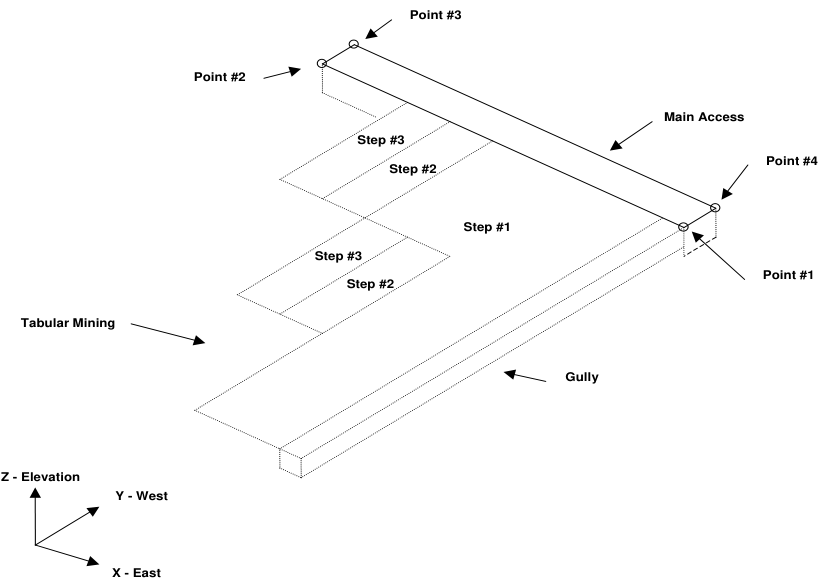

Os pontos 3 e 4 serão gerados deslocando-os a partir da linha definida pelos pontos 1 e 2. Para isso, selecione

#### CAD > Build > Offset Remaining

na barra de ferramentas de construção.

Será solicitado o vetor de deslocamento.

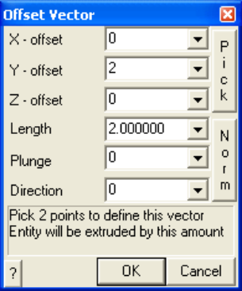

Informe o deslocamento

X - offset: 0

Y - offset: 2

#### Z - offset: 0

Isso gerará os pontos 3 e 4 e concluirá a construção do DDLoop.

Você será automaticamente solicitado a informar as propriedades do bloco

Informe o seguinte:

#### Block Name: Main Access

#### Element Type: Fictitious Force

Ao fazer isso, será solicitado o vetor de deslocamento que será usado para extrudar o bloco.

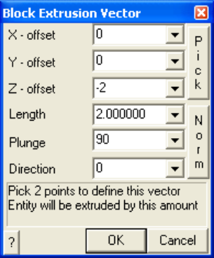

Informe o deslocamento:

X - offset: 0 Y - offset: 0 Z - offset: -2

Block Colour: 1 Fixed Element Width:   (deixe desmarcado)

Esse acesso deve ser escavado na etapa de lavra 1. Isso é indicado especificando

Mining Step 1: 0

Terminamos e podemos construir esse bloco.

#### Construção do gully

Agora construa o gully com o mesmo procedimento descrito acima.

Selecione os dois primeiros pontos como mostrado na figura.

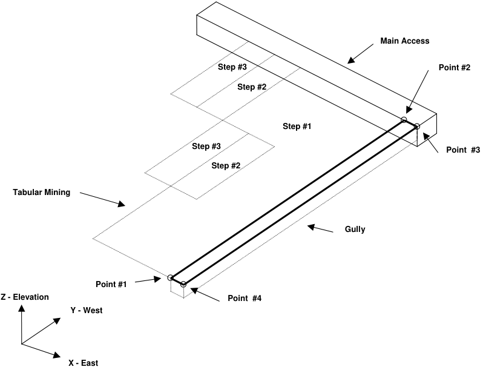

Os pontos 3 e 4 serão gerados deslocando-os a partir da linha definida pelos pontos 1 e 2. Para isso, selecione

CAD > Build > Offset Remaining

na barra de ferramentas de construção.

Será solicitado o vetor de deslocamento.

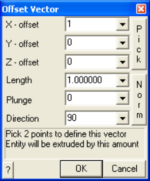

Informe o deslocamento:

- X - offset: 1

- Y - offset: 0

- Z - offset: 0

Isso gerará os pontos 3 e 4 e concluirá a construção do DDLoop.

Você será automaticamente solicitado a informar as propriedades do bloco

#### Informe o seguinte:

#### Block Name: Gully

#### Element Type: Fictitious Force

Ao fazer isso, será solicitado o vetor de deslocamento que será usado para extrudar o bloco.

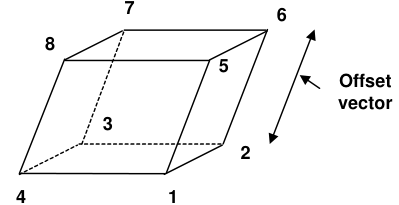

Informe o deslocamento:

X - offset: 0 Y - offset: 0 Z - offset: -1

Block Colour: 1

Fixed Element Width:   (deixe desmarcado)

Esse acesso deve ser escavado na etapa de lavra 1. Isso é indicado especificando

Mining Step 1: 0

Terminamos e podemos construir esse bloco.

#### Discussão

Antes de prosseguir com a análise, precisamos modificar o parâmetro de controle Element Length ( _AL_ ) para considerar adequadamente essas novas adições ao modelo

#### CAD > Properties > Control Parameters

AL deve ser igual ao dobro da espessura do gully (o gully tem 1 metro de espessura), pois essa é a feição mais estreita deste modelo.

Se agora discretizarmos o modelo

#### Analysis > Discretization

uma análise cuidadosa mostra que um grande número de elementos de contorno é usado para discretizar as áreas adjacentes ao gully e ao acesso principal. Claramente, essas feições serão caras em termos de tempo de análise. Se elas não forem fatores importantes, é possível obter uma economia considerável de esforço de análise removendo-as da análise. Isso pode ser feito tornando essas feições inativas.

Para isso, selecione

#### Analysis > Go to CAD

na caixa de diálogo de análise. Em seguida, selecione

Analysis > Graphics

Agora selecione

na barra de ferramentas CAD

Isso abrirá a barra de ferramentas de edição

Para editar entidades, selecione

CAD > Edit > Entity Properties

Isso abrirá a barra de ferramentas de edição de entidades

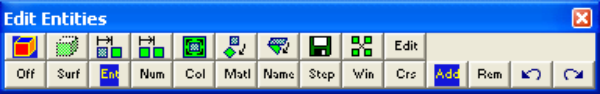

Ao iniciar essa rotina, primeiro será solicitado que você crie uma lista das entidades que deseja editar. Mantenha pressionada a tecla Shift e selecione o gully e o acesso principal. Não selecione a lavra tabular nem o dique.

Depois de selecionar essas feições, selecione novamente

CAD > Edit > Entity Properties

ou clique duas vezes no gully ou no acesso principal para abrir a caixa de diálogo Entity Properties.

Se algum campo da caixa de diálogo mostrar "Variable", é porque alguns dos blocos selecionados têm propriedades diferentes nesse campo. Se quiser manter essas propriedades como estão (ou seja, diferentes para cada bloco), deixe o campo como "Variable". Se quiser alterar o valor desse campo para todos os blocos selecionados, informe o valor desejado.

Neste caso, o único campo que queremos alterar é o parâmetro Element Type. Defina-o como Inactive Fictitious Force

Element Type: Inactive Fictitious Force

e selecione OK.

Agora você pode iniciar novamente a análise BEM selecionando

BEM Analysis

