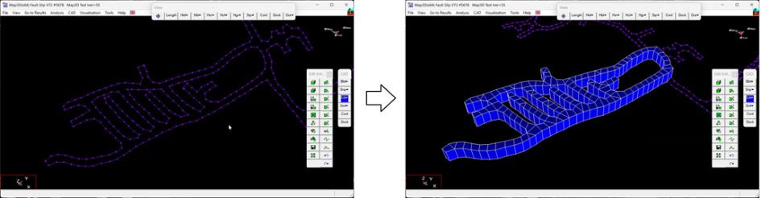

Este exemplo mostra como usar a função DDLoop do Map3D para construir um layout complexo de galerias. O layout contém formas complicadas de pilares internos.

As linhas de construção usadas neste vídeo estão incluídas na versão de demonstração do Map3D e/ou podem ser baixadas de z305_floor_plan-a.dxf

**Demonstração em vídeo da construção de modelos DDLoop com laços internos**
