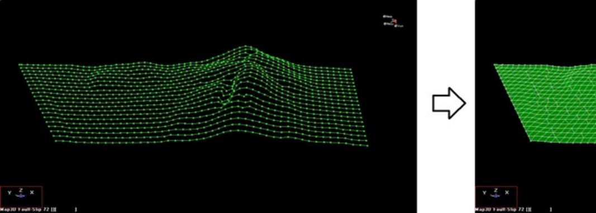

Este exemplo mostra como construir modelos DDLoop no Map3D usando a opção "Snap > Window".

O layout contém várias linhas de construção subparalelas.

As linhas de construção usadas neste vídeo estão incluídas na versão de demonstração do Map3D e/ou podem ser baixadas de lines3a.dxf

**Demonstração em vídeo da construção de modelos DDLoop com a opção Window (lines3a.dxf)**
