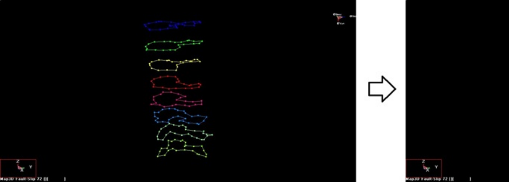

Este exemplo mostra como usar a função FFLoop do Map3D com a nova opção "Snap > Window".

O layout contém vários laços de linhas de construção.

Este vídeo mostra a construção com FFLoop a partir de um conjunto de laços de linhas de construção. As linhas de construção usadas neste vídeo estão incluídas na versão de demonstração do Map3D e/ou podem ser baixadas de 7a.pnt

**Demonstração em vídeo da construção de modelos FFLoop com a nova opção "Win > Snap"**
