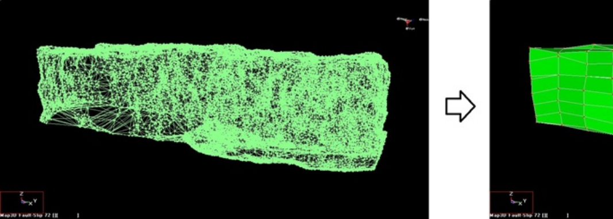

Este exemplo mostra como usar a simplificação de modelos por fatiamento no Map3D. O layout contém uma forma de escavação excessivamente complexa.

Este vídeo mostra a simplificação de uma geometria complexa por "Slicing" (fatiamento), "Smoothing" (suavização) e, em seguida, construção com "FFLoop".

As linhas de construção usadas neste vídeo estão incluídas na versão de demonstração do Map3D e/ou podem ser baixadas de Skivpall.dxf

**Demonstração em vídeo da simplificação de modelos por fatiamento (Skivpall.dxf)**
