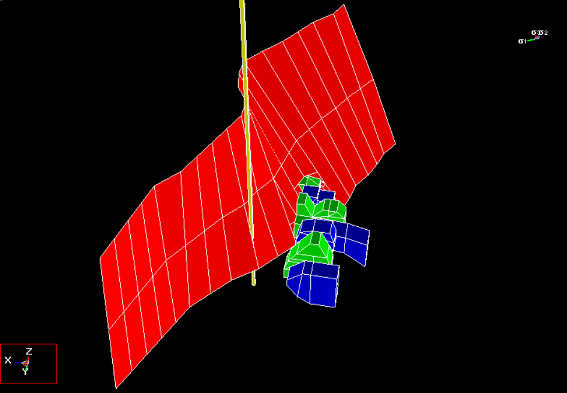

Neste exemplo, vários métodos alternativos de modelagem da ruptura por deslizamento de falha são examinados para avaliar o comportamento pseudoestático do deslizamento. Os resultados da modelagem numérica são usados para comparar essas abordagens, na tentativa de demonstrar que os resultados são válidos e confiáveis.

Exemplo de deslizamento de falha

