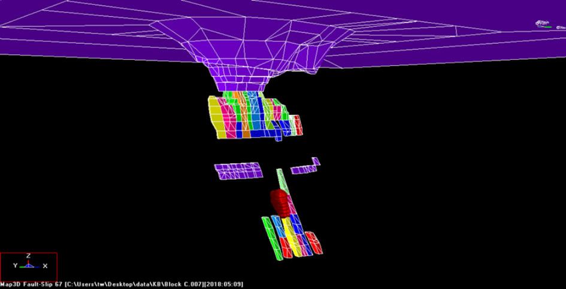

Neste exemplo, a sobrescavação ocorrida em uma etapa anterior da lavra é usada para calibrar um modelo que permita prever o comportamento esperado na lavra de um nível posterior mais profundo.

#### Exemplo KB

