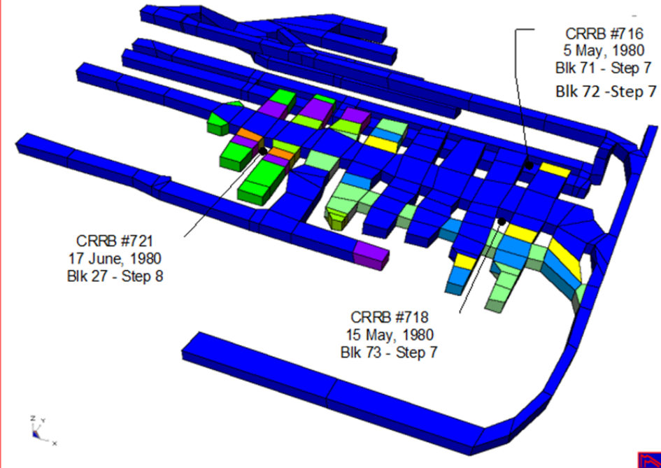

Neste exemplo, ocorreram várias rupturas de pilares durante a fase de abertura de subníveis (silling out) em 3 níveis diferentes. Essas rupturas são usadas para calibrar um modelo que permita prever o comportamento esperado na lavra posterior de um pilar de coroa.

#### Exemplo CR

